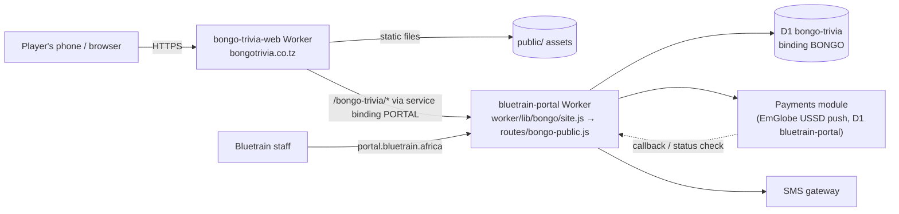

# Bongo Trivia — connecting the player website to the Bluetrain Portal

Version 14 Nov 2026 · Owner: Bluetrain Consultancy · Repos: `alexofio/bongo-trivia-web` (website) and `alexofio/bluetrain-portal` (back end)

**In one line:** the game back end already exists inside the Bluetrain Portal. The website reaches it on its own domain through a Cloudflare service binding: `bongotrivia.co.tz/bongo-trivia/api/*` → `bluetrain-portal`. The website's API adapter is written and tested. To go live: set up the campaign in the portal, move the domain, deploy the website Worker, and switch `MODE` to `'portal'`.

---

## 1. What has been decided

| Item | Decision | Source |
|---|---|---|
| Price | TZS 950 per set of 3 questions | Alex, 14 Nov |
| Payment request | Mobile-money push from **EmGlobe** to the player's own number | Alex, 14 Nov |
| Promoter | Bluetrain Consultancy Ltd. No GBT licence yet; Bluetrain will get one | Alex, 14 Nov |
| Questions | Random across the player's chosen categories and difficulty; 3 options (A, B, C); 15 s each, timed by the server | Alex, 14 Nov; portal 0003 |
| Prizes | All 3 correct → entered into the hourly TZS 5,000 and daily TZS 100,000 draws; winners **picked at random** | Alex, 14 Nov |
| Wrong answer | Player is told to try again (new paid set) | Alex, 14 Nov |
| Sign-in | Phone number + 6-digit SMS code (OTP) for both sign-up and log-in; no passwords | Alex, 14 Nov |
| Categories | As set in the admin panel (Bongo Trivia → Questions); player picks one or more, changes any time | Alex, 14 Nov |
| Legal | Terms + Privacy accepted at sign-up; 18+ confirmed; SMS offers opt-in (unticked) at sign-up; opt-out in Settings and by STOP/ACHA | Alex, 14 Nov |
| First-time help | 4-step "How to play" walkthrough before the first set | Alex, 14 Nov |
| Phase 2 | Watch ads to earn free questions (Perfect 7 ad set-up) — **already built in the portal**, front end shows "Coming soon" | Alex, 14 Nov; portal 0004 |
| Hosting | `bongotrivia.co.tz`, separate GitHub repo, separate Cloudflare Worker `bongo-trivia-web` | Alex, 14 Nov |

Still to confirm: SMS shortcode for STOP/ACHA, sender ID, support phone and email, data retention period, winners per period, which GBT permit, the campaign code, prize hours (the portal defaults to 08:00–20:00 EAT).

---

## 2. How the pieces fit



| Part | Where | Notes |
|---|---|---|
| Website | Repo `alexofio/bongo-trivia-web`, Worker `bongo-trivia-web` | Static HTML/CSS/JS in `public/`, Worker in `worker/index.js` |
| Back end | Repo `alexofio/bluetrain-portal`, Worker `bluetrain-portal` | Player and agent API: `worker/routes/bongo-public.js`. Engine: `worker/lib/bongo/*`. Admin: `worker/routes/bongo-admin.js`, `public/assets/bongo-admin.js` |
| Database | D1 `bongo-trivia` (id `07ad4159-8fc7-4c90-9a5d-359173715b87`), binding `BONGO` | Migrations in `migrations-bongo/` (0001–0004) |
| Payments | Portal Payments module, source `bongo` | `worker/lib/bongo/entries.js` → `payments/core.js`; hook marks `bt_entries` paid |
| Domain | `bongotrivia.co.tz` (+ `www`, redirected to the apex) | Must be on the Bongo Trivia website Worker, not the portal |
| Staff admin | `portal.bluetrain.africa` → Bongo Trivia | Campaigns, Questions, Players, Agents, Finance, Messaging, Settings |

**Why a service binding:** the browser stays on one origin (`bongotrivia.co.tz`). There's no CORS, the portal host is never exposed to players, and the portal's existing host rule still applies: requests for `bongotrivia.co.tz` only ever reach the Bongo Trivia site code, never the staff portal.

---

## 3. Go-live checklist (in order)

### A. Portal — campaign and settings (Bongo Trivia admin, no code)
1. **Campaigns → New**, with these settings:
   - **code**: e.g. `BONGO` [TBC] — this goes into the website's `CAMPAIGN_CODE`.
   - **model** `A`, **entry_mode** `paid`, **entry_price_tzs** `950`.
   - **questions_per_round** `3`, **seconds_per_question** `15`, **pass_mark** `3`.
   - **max_rounds_hour / max_rounds_day**: defaults are 5 / 30 [TBC].
   - **categories**: leave empty to use all active ones, or choose them.
   - Set **terms_version** and **permit_no** when the permit exists. Set **status** `live`.
2. **Winning configuration** (prize settings, table `bt_prize_config`), two active rows:
   - **hourly**: 1 winner, TZS 5,000, method `random_draw`, eligibility `qualifiers`, hours 08–20 [TBC].
   - **daily**: 1 winner, TZS 100,000, method `random_draw`, eligibility `qualifiers`.
3. **Finance → Collect payments: on.** When it's off, paid campaigns play free and the website automatically shows "Play 3 questions free" and skips the payment step.
4. **Settings:**
   - `public_base_url` = `https://bongotrivia.co.tz`.
   - `allowed_origins` already holds the bongotrivia origins; it isn't needed with the binding, but keep it.
   - Set the OTP and welcome SMS templates, plus `sender_id` once BONGOTRIVIA is approved.
5. **Questions:** at least 3 approved questions per category (more like 500 each for launch). Each needs 3 options, a difficulty, and Swahili text with English optional.

### B. Portal — code (recommended before launch; see §6)
6. Add migration `0005_player_prefs.sql` and the small route changes in §6.1–6.3 (player categories, tutorial flag, multi-category rounds, draw-entry counts). Until then the website keeps category choices and the tutorial flag on the device, picks one category per round from the player's choices, and hides the draw-entry tally.
7. `npx wrangler d1 migrations apply bongo-trivia --remote`, then deploy the portal (Workers Builds on push to `main`).

### C. Cloudflare — move the domain
8. Check that the `bongotrivia.co.tz` zone is in the Bluetrain Cloudflare account and its nameservers point to Cloudflare. Look under Websites → `bongotrivia.co.tz` → Overview: status should be **Active**.
9. Workers & Pages → `bluetrain-portal` → Settings → Domains & Routes: **remove** `bongotrivia.co.tz` and `www.bongotrivia.co.tz` if they're listed. They aren't in the portal's `wrangler.jsonc`, but `worker/lib/bongo/site.js` answers for them, so they may have been added in the dashboard.
10. Deploy the website: in `bongo-trivia-web`, run `npm ci && npx wrangler deploy` (or connect the repo in Workers Builds). This attaches both custom domains and the `PORTAL` binding.

### D. Website — switch on the real back end
11. `public/js/config.js`:
    - `MODE: 'portal'`
    - `CAMPAIGN_CODE: '<the code from step 1>'`
    - fill `SMS_SHORTCODE`, `SUPPORT_PHONE`, `SUPPORT_EMAIL` and `GBT_PERMIT` when known.
12. `public/_headers`: delete the `X-Robots-Tag` line. `public/robots.txt`: replace it with `User-agent: *\nAllow: /\nDisallow: /bongo-trivia/`.
13. Commit to `main` and deploy.

### E. Smoke test on the live domain (one real phone per network)
14. Run through each of these:
    - Sign up: the SMS code arrives and verifies.
    - Pick categories; the walkthrough shows.
    - Play: the EmGlobe push arrives; approving it opens the questions; declining shows the "declined" message.
    - Answer 3 correctly to get the draw message; answer 1 wrong to get "try again".
    - In Settings, switch SMS offers off; check the portal Players screen shows the opt-out.
    - Agent link `bongotrivia.co.tz/r/<CODE>` → sign up → the agent's Subscribers count goes up.
    - Log out, then log in again with the same number.
    - Payment request on a Halotel number: expect a clear refusal.

---

## 4. Website ↔ portal API mapping

Base path: `/bongo-trivia/api` (same origin). Auth: `Authorization: Bearer <token>` from `/auth/verify`. The token is 64 hex characters, lasts 30 days, and is stored in `localStorage` as `bt_token`. Every request sends `Accept-Language: sw|en`. Errors come back as `{ "error": "<sentence>" }` with an HTTP status.

| Screen / action | Website function (`public/js/api.js`) | Portal endpoint | Notes |
|---|---|---|---|
| App start | `API.categories()` | `GET /campaigns/:code` | Loads categories, price, questions, seconds, prizes and `entry.playMode`, and overrides `BT_CONFIG` |
| Agent link | `API.trackClick()` | `POST /click` | Fires automatically on `?ref=`; the token is sent at verify |
| Sign up / Log in — send code | `API.sendOtp(msisdn)` | `POST /auth/start {phone, locale}` → `{otpId, expiresIn}` | One endpoint for both; codes last 10 min; 3 per 10 min per number |
| Verify code | `API.verifyOtp(...)` | `POST /auth/verify {otpId, phone, code, adult, marketing, locale, campaign, channel, click, ref, subid, utm, device}` → `{token, player}` | `adult:true` is required for new numbers. A log-in with an unknown number returns "confirm your age", which the website shows as "not registered, create an account" |
| Session check | `API.me()` | `GET /me` → `{player}` | 401 clears the token and sends the player to log-in |
| Save categories | `API.saveCategories(ids)` | `POST /me {categories}` | Ignored until §6.1; kept on the device meanwhile |
| SMS offers on/off | `API.saveConsents(bool)` | `POST /me {marketing}` | Off adds a `bt_suppressions` row (scope marketing) |
| Language | `API.savePreferences(lang)` | `POST /me {locale}` | |
| Tutorial seen | `API.completeTutorial()` | `POST /me {tutorialDone:true}` | Ignored until §6.1; kept on the device meanwhile |
| Play (paid) | `API.startPlay()` | `POST /entries {campaign, rounds:1}` → `{entry}` | Sends the EmGlobe USSD push. 409 if a prompt was sent in the last 2 min; 6 prompts / 10 min per player |
| Waiting for payment | `API.paymentStatus(entryId)` | `GET /entries/:id` (every 2 s, 90 s max) | `paid` → website calls `POST /rounds`. `failed` → declined or failed. `expired` → timed out |
| Start questions | (inside `paymentStatus`) | `POST /rounds {campaign, entryId, category, categories, channel:'web', device}` → `{id, total, seconds, question}` | One round per paid entry (atomic in the portal) |
| Play (payments off / free) | `API.startPlay()` | `POST /rounds {campaign, ...}` | No push; the website skips the payment screens |
| Show question | `API.question(roundId)` | Next question comes with each answer; fallback `GET /rounds/:id` → `{status, msLeft, question}` | Options are strings; the website uses their index (0–2) as the id |
| Answer | `API.answer(roundId, {question_id, option_id})` | `POST /rounds/:id/answer {index, choice}` → `{ok, correctIndex, timedOut, done, question?|result?}` | `choice: null` = time ran out. Server grace 1.5 s |
| Result | `API.result(roundId)` | From the last answer (or `GET /rounds/:id`) | The website builds the answer summary from the answers it sent and received |
| Draw entries tally | `API.entries()` | `GET /me/draw-entries?campaign=` (§6.3) | Hidden until it exists |
| Log out | `API.logout()` | `POST /auth/logout` | Deletes the session row |
| SMS opt-out link | — | `GET /bongo-trivia/s/:token` | Served by the portal through the binding |

Phase 2 (already in the portal, not yet in the website): `GET /ads?campaign=`, `POST /ads/next {campaign, device}`, `POST /ads/:token/complete`, `POST /ads/:token/click`, `GET /ad-media/:token`. A completed ad gives one free round (3 a day by default), which `POST /rounds` uses automatically when the player has no paid entry.

---

## 5. Endpoint details (as implemented in `bongo-public.js`)

```http
GET /bongo-trivia/api/campaigns/BONGO
200 {
  "campaign": { "code": "BONGO", "name": "...", "status": "live",
    "entry": { "mode": "paid", "priceTzs": 950, "playMode": "paid", "freePlay": false },
    "questions": 3, "seconds": 15, "passMark": 3, "roundsPerHour": 5, "roundsPerDay": 30, "terms": "v1", "permit": null },
  "categories": [ { "id": "cat_a", "code": "A", "name_sw": "Tanzania", "name_en": "Tanzania", "icon": null } ],
  "prizes": [ { "tier": "hourly", "winners_per_period": 1, "amount_tzs": 5000, "method": "random_draw", "start_hour": 8, "end_hour": 20, "how": "Random draw among qualifiers" } ]
}

POST /bongo-trivia/api/auth/start      {"phone":"+255712345678","locale":"sw"}
200 {"otpId":"otp_...","expiresIn":600}
429 {"error":"Too many codes. Wait 10 minutes and try again."}

POST /bongo-trivia/api/auth/verify
{"otpId":"otp_...","phone":"+255712345678","code":"123456","adult":true,"marketing":false,"locale":"sw",
 "campaign":"BONGO","channel":"web","click":"<32 hex>","subid":"wa1","utm":{"utm_source":"wa"},"device":"<random id>"}
200 {"token":"<64 hex>","player":{"id":"ply_...","locale":"sw","status":"active","marketing_opt_in":0,"campaigns":[...],"wins":[...]}}
400 {"error":"That code is wrong. Check the SMS and try again."}
400 {"error":"Bongo Trivia is for players aged 18 and over. Please confirm your age."}

POST /bongo-trivia/api/entries    {"campaign":"BONGO","rounds":1}
200 {"entry":{"id":"ent_...","rounds":1,"used":0,"amount_tzs":950,"status":"pending","left":0}}
409 {"error":"A payment prompt was just sent. Check your phone."}
409 {"error":"Play is free right now: no payment needed."}

GET /bongo-trivia/api/entries/ent_...
200 {"entry":{"id":"ent_...","status":"pending|paid|failed|expired","error":null,"left":1}}

POST /bongo-trivia/api/rounds     {"campaign":"BONGO","entryId":"ent_...","category":"cat_h","channel":"web","device":"..."}
200 {"id":"rnd_...","total":3,"seconds":15,"question":{"index":0,"total":3,"text":"...","options":["A","B","C"],"image":null},"free":null}
402 {"error":"This round needs a paid entry. Buy one, or watch an ad for a free play."}
429 {"error":"You can play 5 rounds an hour. Try again next hour."}
503 {"error":"Not enough questions in this category yet. Try another one."}

POST /bongo-trivia/api/rounds/rnd_.../answer   {"index":0,"choice":2}
200 {"ok":true,"correctIndex":2,"timedOut":false,"done":false,"question":{...}}
200 {"ok":false,"correctIndex":1,"timedOut":false,"done":true,"result":{"correct":2,"total":3,"score":180,"timeMs":21000,"qualified":false}}
```

---

## 6. Gaps and proposed portal changes

The website already works with the portal as it is today; each gap below has a fallback in place. These changes close the gaps properly.

### 6.1 Player category choices and tutorial flag (migration + `POST /me`)
`migrations-bongo/0005_player_prefs.sql`:
```sql
-- Bongo Trivia player web (14 Nov 2026): the player's chosen categories and the first-time walkthrough.
ALTER TABLE bt_players ADD COLUMN categories_json TEXT NOT NULL DEFAULT '[]';
ALTER TABLE bt_players ADD COLUMN tutorial_done_at TEXT;
```
`worker/routes/bongo-public.js`, inside `POST /me`, after the marketing block:
```js
if (Array.isArray(b.categories)) {
  const ids = [...new Set(b.categories.map(String))].slice(0, 20);
  const { results } = await env.BONGO.prepare(`SELECT id FROM bt_categories WHERE active = 1`).all();
  const ok = new Set(results.map((r) => r.id));
  if (!ids.length || ids.some((i) => !ok.has(i))) fail(400, "Pick at least one category from the list.");
  stmts.push(env.BONGO.prepare(`UPDATE bt_players SET categories_json = ? WHERE id = ?`).bind(JSON.stringify(ids), pl.id));
}
if (b.tutorialDone === true) stmts.push(env.BONGO.prepare(`UPDATE bt_players SET tutorial_done_at = COALESCE(tutorial_done_at, ?) WHERE id = ?`).bind(now(), pl.id));
```
In `meView`, select `categories_json, tutorial_done_at` and return `categories: S.j(pl.categories_json, [])` (then drop `categories_json`). The website reads `player.categories` and `player.tutorial_done_at` as soon as they appear.

### 6.2 Questions from all chosen categories in one round
`POST /rounds` passes `categoryIds: Array.isArray(b.categories) ? b.categories : null` to `E.startRound`. In `startRound`, replace the category selection with:
```js
const want = (categoryIds || []).map(String).filter((id) => !allowed.length || allowed.includes(id));
const list = cat ? [cat] : want.length ? want : allowed;
const catSql = list.length ? `category_id IN (${list.map(() => "?").join(",")})` : "1 = 1";
const catB = list;
```
Optional, for the "mixed difficulty" rule: pick one easy, one medium and one hard (`ORDER BY RANDOM() LIMIT 1` per difficulty), and fall back to any difficulty when one is empty. The website already sends both `category` (one of the player's choices) and `categories` (all of them).

### 6.3 Draw entries for the Play screen
In the signed-in section of `bongo-public.js`:
```js
if (p === "/me/draw-entries" && m === "GET") {
  const c = await S.campaign(env, url.searchParams.get("campaign") || "");
  const r = await env.BONGO.prepare(`SELECT SUM(hour_key = ?) AS h, COUNT(*) AS d FROM bt_rounds
    WHERE campaign_id = ? AND player_id = ? AND day_key = ? AND status = 'finished' AND qualified = 1`).bind(R.hourKey(), c.id, pl.id, R.dayKey()).first();
  return json({ hourly_current: r.h || 0, daily: r.d || 0 });
}
```

### 6.4 Error codes and Swahili messages
The website currently recognises errors by their English text (`codeFor()` in `api.js`). Proposal: send `{ error, code }` from `fail()`, with codes such as:
- `invalid_code`, `expired_code`, `too_many_attempts`, `age_required`
- `payment_pending`, `limit_reached`, `payment_required`, `rate_limited`

Also pick the message language from `Accept-Language`. Once that's live, `codeFor()` reads `data.code` first.

### 6.5 Nice to have
- `publicQuestion` returns `category_id` and `difficulty`, so the question card can show "Hesabu · Medium".
- `GET /rounds/active?campaign=` lets a player resume a round after a reload; the round stays `open` until answered or timed out.
- Expose a payment decline as entry status `cancelled` (today it's `failed` with the gateway text in `error`).

---

## 7. Rules the back end enforces (the website relies on these)

- **Phone format:** `normalisePhone` accepts `07…`, `06…`, `7…`, `+2557…` and `2557…`, and stores `+255…`. Numbers are kept as an HMAC hash plus an AES-GCM copy (`BONGO_DATA_KEY`).
- **Codes:** 6 digits, valid 10 min, 5 wrong tries kills the code; 3 codes per 10 min per number and 30 per hour per network.
- **Questions:**
  - The server picks approved questions in the campaign's categories, avoiding the player's last 10 rounds.
  - It times each question from when it's asked: `seconds_per_question` plus 1.5 s grace.
  - Grading happens on the server; the right answer is only revealed after the answer is sent.
- **Caps:** `max_rounds_hour` / `max_rounds_day` per player; only one open round at a time.
- **Draws:**
  - Seeded random draw among the period's qualifying rounds (`eligibility qualifiers`, `pass_mark 3` = all correct).
  - The seed hash is committed before the period opens.
  - At most one instant win per number per day.
  - Winners get an SMS and are paid through Finance → Pay by EmGlobe.
- **Fraud flags:** all answers under 1.2 s each, 4+ numbers on one device a day, 15+ numbers on one network an hour.
- **SMS:**
  - Marketing only to `marketing_opt_in = 1` players without a suppression.
  - Window 08:00–20:00, at most 3 a week.
  - Every marketing SMS carries an opt-out link at `/bongo-trivia/s/<token>`.
- **Agents:**
  - A typed code or keyword wins; otherwise a link click in the last 30 days counts.
  - Attribution is fixed for 90 days.
  - Commissions are paid out by cash request, minimum TZS 50,000.

---

## 8. The website (repo `alexofio/bongo-trivia-web`)

```
wrangler.jsonc        Worker bongo-trivia-web: assets, custom domains, PORTAL service binding, run_worker_first /bongo-trivia/*, /r/*
worker/index.js       www → apex; /bongo-trivia/* → env.PORTAL; /r/CODE[/CAMPAIGN] → /?ref=CODE&c=CAMPAIGN (+ s, utm_*)
public/index.html     Shell: header (logo, nav), <main id="app">, live region #live, footer; loads the scripts below in order
public/_headers       CSP (self + Google Fonts), HSTS, nosniff, frame and permissions policy; noindex during the demo
public/css/styles.css Brand tokens (#023DC1 → #0087F0, ribbon #FFE22E), light/dark, all components
public/js/config.js   MODE, API_BASE, CAMPAIGN_CODE, price/timers/prizes (overridden by the campaign), [TBC] legal values
public/js/i18n.js     Every interface string in Swahili and English
public/js/api.js      The adapter: mock or portal, same functions either way (§4)
public/js/mock-api.js Demo back end mirroring the portal (3 options, portal category ids, code 123456)
public/js/legal.js    Terms and Conditions + Privacy Policy drafts
public/js/app.js      Hash router and screens; first-time walkthrough
public/img/           Logos (white for blue, blue for white), app icons, share image (FB cover)
```

**Screens** (hash routes): `#home`, `#signup`, `#login`, `#verify`, `#categories`, `#play` (+ payment notice dialog, + walkthrough dialog), `#pay`, `#quiz`, `#result`, `#settings`, `#terms`, `#privacy`.

**Element ids the code binds to** (stable; keep them if you restyle):
- **Sign-in and categories:** `#phone`, `#cTerms`, `#cAge`, `#cSms`, `#send`, `#code`, `#vbtn`, `#resend`, `#cats`, `#save`.
- **Play and payment:** `#playBtn`, `#notice`, `#nOk`, `#nNo`, `#howBtn`, `#pf`, `#payBody`, `#retry`.
- **Questions and results:** `.opt-btn[data-id]`, `#fb`, `#nx`, `#again`.
- **Settings and walkthrough:** `#sms`, `#tourAgain`, `#logout`, `dialog.tour` (`#tNext`, `#tBack`, `#tSkip`, `#tPlay`, `#tLater`).

**Device storage** (portal mode):
- `bt_token`: session.
- `bt_phone`: the player's number, for display.
- `bt_prefs_<phone>`: categories and tutorial flag, until §6.1.
- `bt_ref`: agent referral.
- `bt_device`: random id for the fraud checks.
- `bt_lang`: language.

**Security notes:**
- The bearer token lives in `localStorage`, as the portal API was designed. A strict CSP (no inline script, no third-party script) limits the XSS risk.
- The PIN is never asked for on the site.
- Phone numbers are only shown to their owner; winner lists come masked from the portal.

---

## 9. Testing

- **Demo:** `npm run dev` with `MODE: 'mock'` (code 123456). The demo's payment-outcome buttons cover success, failed, declined, timed out and limit.
- **Contract test:** the portal adapter was run end to end against a stand-in server that returns the same JSON shapes as `bongo-public.js`. It covered:
  - sign-up with an agent referral, a wrong then a right code, and categories;
  - the walkthrough, a paid entry and its polling, round start, three answers and the result;
  - the SMS opt-out, a failed payment, payments-off free play, and log-in with an unknown number.
  - All passed.

  It wasn't run against the live portal: that needs the campaign (step A), and this session has no Cloudflare credentials.
- **Live:** the smoke test in §3 E.

---

## 10. Open items

| Item | Owner | Blocks |
|---|---|---|
| Campaign code and dates; prize hours (08–20?) and winners per period | Alex | Go-live |
| GBT permit route and number (Bluetrain as promoter) | Alex / counsel | Paid launch |
| Move `bongotrivia.co.tz` from the portal to `bongo-trivia-web`; confirm the zone is active | Alex (Cloudflare) | Go-live |
| Portal changes §6.1–6.3 | Developer | Nothing (fallbacks in place) |
| SMS shortcode (STOP/ACHA), sender ID BONGOTRIVIA, support phone and email | Alex | Legal pages |
| Data retention period | Alex / counsel | Privacy Policy |
| Swahili legal text; native-speaker pass on the interface | Bluetrain | Launch |
| Phase 2 ads screen on the website (portal API exists) | Developer | Phase 2 |
